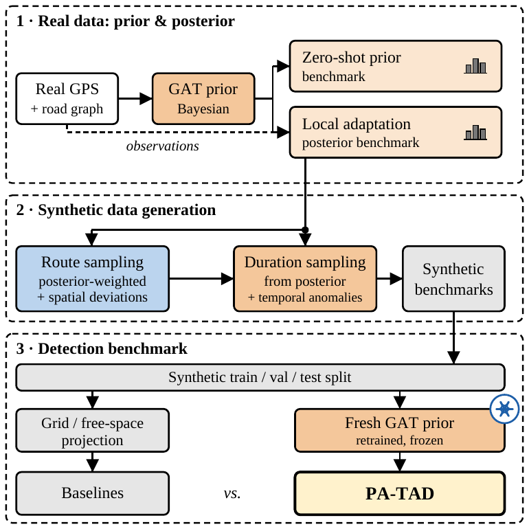
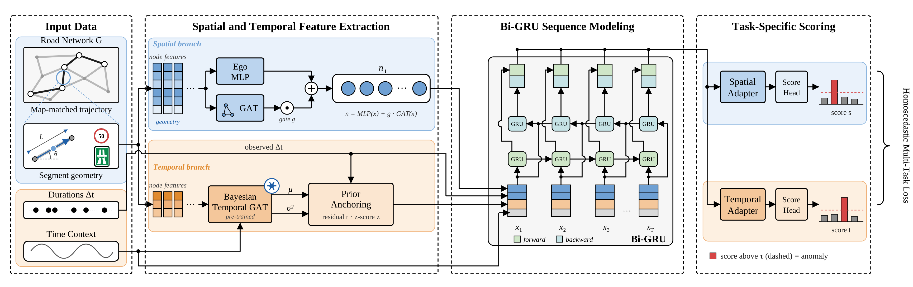

# PA-TAD: Prior-Anchored Trajectory Anomaly Detection

Code for the paper **"Prior-Anchored Trajectory Anomaly Detection"** (under review).

PA-TAD detects spatial, temporal, and compound spatio-temporal anomalies in map-matched
trajectories on road networks up to national scale.

<p align="center">
  
</p>

The pipeline has three stages:

1. **Bayesian GAT travel-time prior** on real data, anchored to free-flow travel times, with
   closed-form local posterior updates for observed segments.
2. **Physics-constrained benchmark engine** that generates labelled spatial (SPRW, Detour,
   Overshoot), temporal (AR(1) congestion), and compound anomalies natively on the road graph.
3. **PA-TAD detector**: a dual-head Bi-GRU that scores every traversed edge, with memory
   linear in trajectory length. **PA-TAD-Lite** is the prior-free variant.

<p align="center">
  
</p>

## Repository structure

| Folder | Contents |
|---|---|
| `src/01_data_prep/` | Data extraction, map enrichment, preprocessing, cold-start edge split (Danish and Porto) |
| `src/02_prior_modeling/` | Free-Flow, XGBoost, and Bayesian GAT priors; evaluation (Table IV); posterior map |
| `src/03_anomaly_generation/` | Benchmark engine, train/val/test split, input bridges for grid and free-space baselines |
| `src/04_baselines/` | Shared evaluation code (`baseline_helpers.py`) and our GETAD reimplementation |
| `src/05_TAD/` | PA-TAD, PA-TAD-Lite, multi-seed runner, and ablation study |
| `docs/` | Figures used in this README |

Scripts read from and write to `data/`, `models/`, `outputs/`, and `results/` in the repository
root. Run all commands from the repository root.

```
data/
  01_raw/          # inputs: Porto train.csv (download, see below)
  02_interim/      # intermediate files written by src/01_data_prep
  03_processed/    # map-matched trajectories and maps
models/            # trained priors
outputs/           # checkpoints, per-seed score archives (.npz), logs
results/           # metric tables (CSV) and figures
```

Only `data/01_raw/` needs to be filled by hand; every other folder is created by the scripts.

## Setup

Python 3.11+ and a CUDA GPU are recommended (experiments used one RTX 4090, 24 GB).

```bash
python -m venv .venv && source .venv/bin/activate   # Windows: .venv\Scripts\activate
pip install -r requirements.txt
```

`torch` and `torch_geometric` are pinned in `requirements.txt`, but their wheels depend on your
CUDA version. If installation fails, first install PyTorch for your CUDA version from
[pytorch.org](https://pytorch.org/get-started/locally/), then PyTorch Geometric following the
[official instructions](https://pytorch-geometric.readthedocs.io/en/latest/install/installation.html),
and finally `pip install -r requirements.txt` for the remaining packages.

## Data

- **Porto (public).** Download `train.csv` from the
  [ECML/PKDD 2015 Taxi Service Trajectory dataset](https://doi.org/10.24432/C55W25)
  (CC BY 4.0) into `data/01_raw/`. The road network comes from OpenStreetMap
  (© OpenStreetMap contributors, ODbL).
- **Map matching.** `Porto_01_extraction.py` uses the OSRM `match` service. Run an OSRM
  backend with a Portugal OSM extract (for example the `osrm/osrm-backend` Docker image) and set
  `OSRM_URL` (default `http://localhost:5000`).
- **Denmark (proprietary).** The Danish trajectories cannot be shared. The extraction script
  (`01_extract.py`) is included for transparency; it reads database credentials
  (`DB_HOST`, `DB_PORT`, `DB_NAME`, `DB_USER`, `DB_PASSWORD`) from a `.env` file.

## Reproducing the Porto results

```bash
# Stage 0: data preparation
python src/01_data_prep/Porto_01_extraction.py
python src/01_data_prep/Porto_01_repair_corrupted_map.py
python src/01_data_prep/Porto_02_build_porto_min.py
python src/01_data_prep/03_preprocess.py --traj-file porto_traj_extracted.parquet --tag porto
python src/01_data_prep/04_build_cold_start_split.py --tag porto

# Stage 1: travel-time prior (Table IV)
python src/02_prior_modeling/_05_train_prior.py --tag porto
python src/02_prior_modeling/_06_evaluate_prior.py --tag porto      # Panel A: zero-shot
python src/02_prior_modeling/_07_bayesian_update.py --tag porto     # Panel B: local adaptation
python src/02_prior_modeling/_08_generate_posterior_map.py --tag porto

# Stage 2: synthetic benchmark (Table II)
python src/03_anomaly_generation/09_anomaly_generation.py --tag porto --seed 42
python src/03_anomaly_generation/10_train_test_split_synth.py --tag porto

# Stage 3: detection and scalability (Tables V-VII), seeds 42-44
python src/05_TAD/run_multiseed.py --tag porto
python src/04_baselines/run_multiseed_getad.py --tag porto

# Ablation (Table VIII, Fig. 6), seeds 42-46
python src/05_TAD/ablation_multiseed.py --regions porto

# Recompute Tables V-VI from the saved score archives (all methods)
python src/04_baselines/evaluate_score_archives.py
# Recompute Table VIII and Fig. 6 from the saved ablation archives
python src/05_TAD/ablation_pure_eval.py
```

The Danish benchmarks use `--tag 2016_itsp` with regions `aalborg copenhagen denmark`
(50k, 100k, and 200k generated trajectories by default, as in Table II).

## Evaluation protocol

All methods are scored at the trajectory level with `src/04_baselines/baseline_helpers.py`.
Each benchmark compares one anomaly class against normal trajectories: spatial-only (Table V),
temporal-only, and compound (Table VI).
AUROC and AUPRC are threshold-free. F1 is the best F1 over all decision thresholds, computed
identically for every method. PA-TAD turns edge probabilities into a trajectory score by
averaging the top-k edge probabilities, with k = max(2, ceil(n/4)); compound benchmarks use the
maximum of the spatial and temporal scores. Per-seed score archives are written to
`outputs/anomaly_scores/`, and `run_multiseed.py` writes per-seed metrics and a mean/std summary
to `results/anomaly_detection/`.

## Baselines

`GETAD.py` is our reimplementation of GETAD (Mbuya et al., SIGSPATIAL 2025), as no public
implementation was available at the time of our experiments. The other baselines in the paper
(iBAT, GM-VSAE, MST-OATD, CeTrajad, FoTraj) are not included; they were adapted to our inputs
with `11_GRID_data_bridge.py` (grid-based methods) and
`12_FREESPACE_data_bridge.py` (CeTrajad). See the paper for references.

## Citation

If you use this code or the benchmark engine, please cite:

```bibtex
@misc{rumi2026patad,
  title  = {Prior-Anchored Trajectory Anomaly Detection},
  author = {Rumi, {\'A}d{\'a}m and Skovrup, Peter Lidegaard and Thomsen, L{\ae}rke Ansgaard
            and Yang, Sean Bin and Torp, Kristian},
  year   = {2026},
  note   = {Under review},
  url    = {https://github.com/grigorirasputin/PA-TAD}
}
```

## License

Code: MIT (see `LICENSE`). Porto data: CC BY 4.0. OpenStreetMap data: ODbL.
